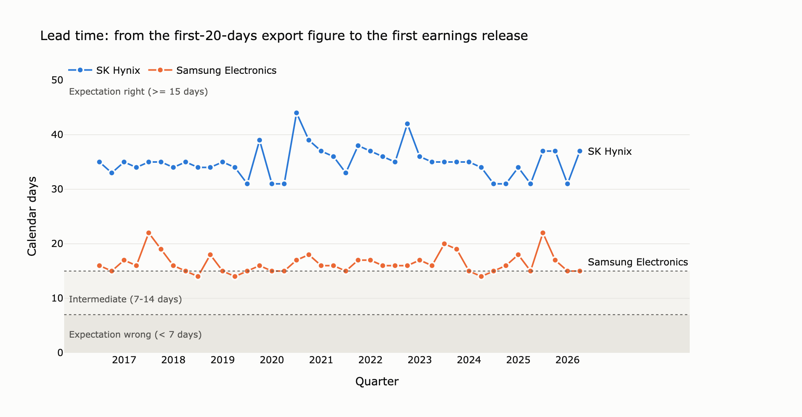
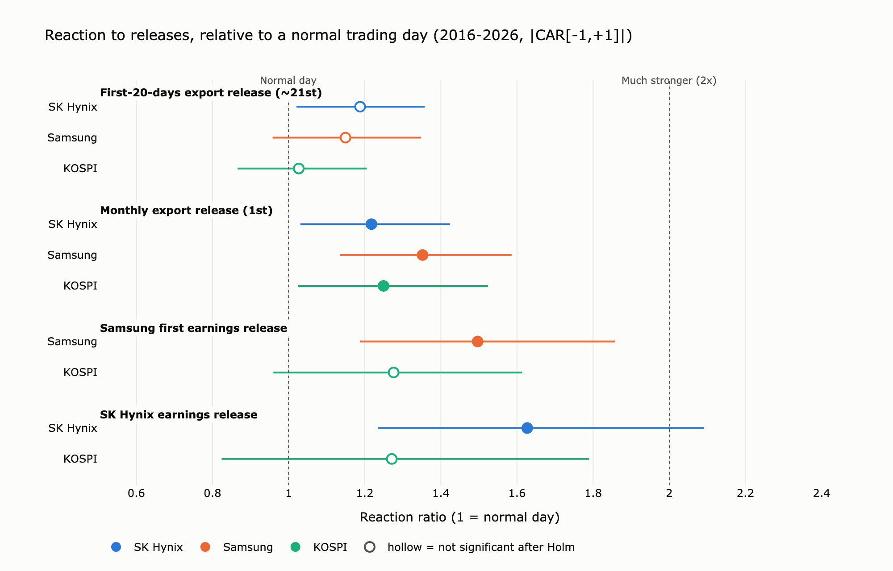
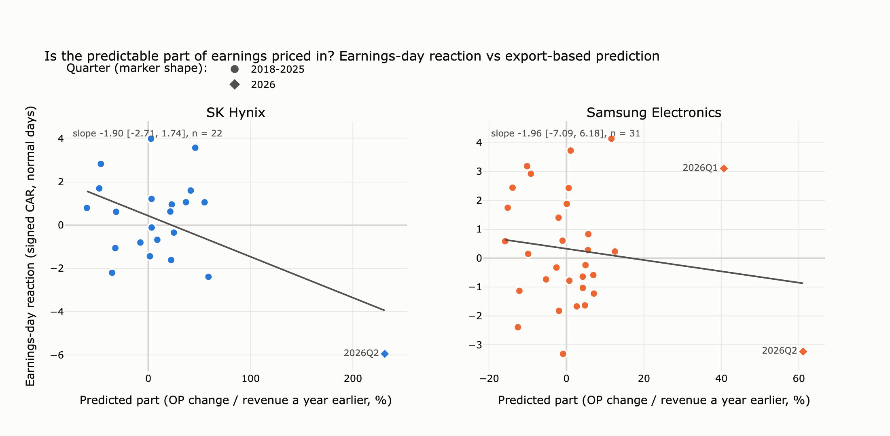

# Chip Canary: Are Korea's Semiconductor Export Figures Already Priced In?

*Release timing, earnings and market reactions, 2016-2026*

**Abstract.** Korea publishes its chip export figures early, around the 21st and the 1st of each month, while SK Hynix, a chip maker, and Samsung, whose results depend heavily on chips, report their earnings weeks later. If investors already watch these figures, do the two firms' earnings still tell the market anything new? I dated every figure by the day it became public and used first-release values where they exist, rebuilding the first-20-days series myself from 121 Korean customs releases, then compared these exports with the earnings reported later and measured how share prices moved on release days, writing down my predictions before seeing any result. Exports known by the 21st track the earnings published two to five weeks later very closely, and for Samsung the link with revenue appears to have strengthened during the AI boom. Yet share prices move only moderately more than usual on release days, and the 20-day figure does not move markets more than the monthly one. Whether this information is already priced in on earnings day remains open: the data are consistent with the idea, but too few to establish it.

## 1. Introduction

Semiconductors have become the core of the South Korean economy: in the first twenty days of September 2026, they made up nearly half of the country's exports, up from less than a fifth at the end of 2023 (47.8% against 17.6% in the first twenty days of December 2023; Korea Customs Service, 21 September 2026 and 21 December 2023). Samsung and SK Hynix are two of the three firms that dominate high-bandwidth memory, the memory used in artificial intelligence chips (TrendForce, 17 September 2025), a sector now central to the world economy and to international relations alike. Korea's export figures, released around the 21st and the 1st of each month, are therefore closely watched by investors worldwide. This note asks a simple question: if these figures already signal how the two firms are doing, do their quarterly earnings still tell the market anything new? To answer it, the note rebuilds the information calendar, from export release to earnings release, and tests predictions written down before seeing any result.

## 2. Data and the information calendar

*In plain terms: this section explains where the numbers come from and, above all, on which day each
one became public, because the whole question is what investors could know, and when.*

Every figure is dated by the day it became public, not by the period it describes. Dating by the
period would use information nobody had at the time, a *look-ahead bias* that makes any "leading
indicator" look better than it was.

**Sources.** The first-20-days report is "closely watched as an early indicator of global trade"
(Bloomberg, republished by Infobae, 21 January 2021). Korea Customs publishes it around the 21st (since
June 2016); the trade ministry publishes the full month on the 1st. Earnings come from each firm's
first *preliminary results filing* (its first, unaudited announcement of quarterly results): Samsung's
early-month estimate, or *guidance*, and SK Hynix's release around the 25th. Prices cover both firms and
the KOSPI (the main Korean stock market index).

**First release, not revised data.** Where possible the note uses the *first release*, the figure as
first published, before any later correction (*revision*), because it is what the market reacted to.
The first-20-days chip export growth was rebuilt from 121 customs releases; the first earnings filings
also state the same quarter a year earlier, giving *year-on-year* growth (the change from a year
before). The full-month figure is the exception: it comes from the Bank of Korea's revised index.

**The calendar** holds 540 events, each dated by its issuer; releases on a weekend or holiday count for
the next *trading day* (day the stock market is open). Monthly dates before 2016 cannot be sourced and
are set by rule in a separate extension sample (2003 to 2015). Appendix A1 lists the traps met.

> **Box 1. Why the first release matters: Samsung, third quarter of 2016.**
> On 7 October 2016, Samsung's first preliminary filing put third-quarter operating profit at about KRW
> 7.8 trillion. On 12 October 2016, after stopping sales, exchanges and production of the Galaxy Note 7,
> Samsung issued a revised guidance of about KRW 5.2 trillion (Samsung Newsroom, 12 October 2016; CNBC,
> 12 October 2016); the detailed results of 27 October 2016 confirmed KRW 5.20 trillion. A revised
> series records only 5.2, while from 7 to 12 October the market knew only 7.8. A study using revised data would
> date the bad news wrongly.

**Table 1. Main data sources**

| Series | Source | Coverage used | Version |
|---|---|---|---|
| Chip exports, first 20 days of the month (y/y %), rebuilt from 121 releases | Korea Customs Service | 2016-07 to 2026-09 | First release |
| Chip export value index, full month (USD) | Bank of Korea, ECOS | 2000-01 to 2026-08 | Revised |
| Revenue and operating profit, Samsung and SK Hynix | OpenDART preliminary filings | 2009Q4 / 2010Q1 to 2026Q2 | First release |
| Daily prices: Samsung, SK Hynix, KOSPI | Yahoo Finance | 2000 to 2026-09-30 | Adjusted |

*Full table, release-date sources and robustness series: appendix A0. Main sample of the analysis:
2016 to 2026, sourced dates only.*

## 3. Who knows first? Exports versus earnings

*In plain terms: Korea's chip export figures are public several weeks before Samsung and SK Hynix
announce their results, and they move very closely with those results, for both companies.*

**Setting.** The information date t is the first-20-days release for the quarter's last month. At t the
market knows about eight ninths of the quarter's exports, combined into one year-on-year growth rate.
Earnings are each firm's first release; operating profit, which sometimes changes sign, enters as its
year-on-year change divided by revenue a year earlier. Sample: 2016Q3 to 2026Q2, 39 quarters per firm.

**The lead is weeks, not days.** Results follow the first-20-days figure by a median of 35 days for SK
Hynix and 16 days for Samsung (Figure 1), just above Samsung's *pre-registered* threshold of 15 days
(written down before any result, so the bar could not be moved). From the monthly release on the 1st,
Samsung's guidance follows after only 6 days.

**The link is very strong** (Table 2). The *correlation* (from -1 to 1, how closely two series move
together) between exports known at t and the results released two to five weeks later is 0.90 to 0.95,
*statistically significant* (very unlikely by chance) even after a *Holm correction*, which makes each
test stricter when many are run. The 95% *confidence interval*, the range of values compatible with the
data, is given by the standard formula (Fisher) and by a *block bootstrap*, a resampling method that
keeps consecutive quarters together.

**Table 2. Exports known at t and first-release earnings, 2016Q3-2026Q2 (n = 39 per cell)**

| Firm | Earnings measure | r | 95% CI (Fisher) | 95% CI (block bootstrap) | Expected | Outcome |
|---|---|---|---|---|---|---|
| SK Hynix | Revenue growth | 0.95 | 0.90 to 0.97 | 0.82 to 0.98 | very strong | as expected |
| SK Hynix | Operating profit change | 0.94 | 0.89 to 0.97 | 0.79 to 0.98 | medium or strong | stronger than expected |
| Samsung | Revenue growth | 0.90 | 0.81 to 0.95 | 0.65 to 0.94 | medium or strong | stronger than expected |
| Samsung | Operating profit change | 0.92 | 0.86 to 0.96 | 0.82 to 0.96 | weak or medium | stronger than expected |

*Categories: weak < 0.3, medium 0.3 to 0.6, strong 0.6 to 0.8, very strong 0.8 or more, fixed before the
results. For the second and third rows the bootstrap interval reaches "strong", so the outcome is
conclusive with the Fisher interval only.*

**No clear gap between firms or measures.** The link was expected to be weaker for Samsung, whose chips
are only part of the group, and for operating profit, which also depends on costs. Neither gap is
confirmed. A possible reading, not tested here: memory prices drive both sales and margins.

**Structural for SK Hynix; the AI boom may matter for Samsung.** Before 2023, SK Hynix's correlations
are unchanged (0.94), while Samsung's revenue correlation falls to 0.72 (95% CI 0.45 to 0.87). This is
*descriptive* (shown, not formally tested): the intervals overlap. Results are robust to other checks
(appendix A4).

**What this part does not show.** SK Hynix's sales largely are Korea's chip exports, so part of the link
is accounting, not forecasting. Whether exports tell the market anything new is the subject of
sections 4 and 5.

*Figure 1. Lead time from the first-20-days export figure of the quarter's last month to each firm's first earnings release, by quarter, with the pre-registered thresholds.*

## 4. Do markets react on release days?

*In plain terms: on the days these figures are published, share prices move somewhat more than on an
ordinary day, but not much more, and the pattern looks like a reaction to general economic news
rather than to chips specifically.*

**Method.** An *event study* (MacKinlay, 1997) compares what happens around a known date with what
would normally happen. For each release and stock, the normal return is estimated over the preceding
250 trading days; the excess over it is the *abnormal return*, and its sum over the day before, the day
of and the day after the release is the *cumulative abnormal return* (CAR). The *reaction ratio* divides
the absolute CAR by the average move over three ordinary days of the same year: 1 means an ordinary
day, 2 twice as much. Significance comes from a *permutation test* against thousands of random ordinary
days, Holm-adjusted over 22 tests. Releases overlapping another type of release are left out.

**Release days are somewhat busier, never much busier** (Figure 2). Moves are 22% (SK Hynix), 35%
(Samsung) and 25% (KOSPI) larger than usual after the monthly release, all significant after Holm;
19%, 15% and 3% after the first-20-days release, none significant; 50% and 63% after the two firms'
results. No ratio reaches 2. Without 31 July 2026, the KOSPI's record day, which falls in one monthly
window, the monthly estimates barely change but SK Hynix's and the KOSPI's no longer pass Holm.

**The pre-registered contrasts are not found.** The earlier first-20-days figure does not move markets
more than the monthly one, and once scaled by its own volatility SK Hynix reacts no more than Samsung or
the index. The comparison before and after 2016 cannot be interpreted: rule-based dates, if wrong,
measure ordinary days and push the ratio toward 1, the level observed.

**A possible reading, not tested.** Markets may respond to the overall economic signal rather than to
chips: the monthly release covers all exports, and the index reacts as much as the chip stocks. Other
first-of-month news, such as manufacturing surveys (PMIs), may also play a part.

**Robustness.** Against the US chip index (SOX), SK Hynix's reaction to the first-20-days figure becomes
significant (1.30), a fragile result; other checks are in appendix A4.

*Figure 2. Reaction ratio by release type and stock (1 = ordinary day), with 95% intervals; hollow markers are not significant after Holm correction.*

## 5. Is the predictable part already priced in?

*In plain terms: if investors had already used the export figures, share prices should not react on
results day to the part of the results those figures announced; the data are compatible with this,
but they are too few to prove it.*

**The test.** If the part of results that exports announced was *priced in* (already in the share price),
the reaction on results day should not depend on it. This predicted part comes from a *regression* (a
line fitted between export growth and operating profit) on an *expanding window*, using only quarters
already public, to avoid look-ahead. The test asks whether the signed reaction rises with it.

**Compatible with "priced in", but not informative.** Neither slope differs significantly from zero
(Figure 3): -1.90 for SK Hynix (95% CI -2.71 to +1.74, 22 quarters), -1.96 for Samsung (-7.09 to +6.18,
31 quarters). But SK Hynix's slope rests on one quarter, 2026Q2 (without it, -0.07), and Samsung's sign
depends on 2026 (diagnostics, appendix A4). With such wide intervals, the data fit both a market that
had priced the information in and one that still reacted strongly to it.

**What would settle it:** more quarters, release times, and analysts' forecasts, to measure the
*surprise* relative to expectations (Andersen, Bollerslev, Diebold and Vega, 2003); such forecasts are
commercial and were not available.

*Figure 3. Earnings-day reaction (signed, in ordinary days) against the part of earnings predicted by exports; 2026 quarters marked.*

## 6. Pre-registration and limitations

*In plain terms: the expected results were written down before any calculation, so that the
analysis could not be bent to confirm them; several turned out to be wrong, and this section says
which.*

**Why write expectations first.** A study can find something "significant" by trying until it works
(*p-hacking*). Here the expectations, thresholds and 32 specifications were written in a dated file
before any result, with a log of every run. The expectations themselves were committed to the
project's version history on 7 October 2026, before the first result. Some precisions were added
later but before the corresponding results (for instance the expected category of each correlation);
they are dated in the file, but were committed together with the results, so for them the file's
log, not the version history, attests the order. The process was self-administered, not registered
with an external body.

**Table 3. Expectations written before the results, and outcomes**

| Expectation | Outcome | Verdict |
|---|---|---|
| Lead of exports over results of 15 days or more | 35 days (SK Hynix), 16 days (Samsung) | Right; just above the threshold for Samsung |
| Very strong link for SK Hynix revenue | r = 0.95 | Right |
| Medium or strong link for SK Hynix operating profit | r = 0.94, very strong | Wrong (stronger) |
| Medium or strong link for Samsung revenue | r = 0.90, very strong (0.72 before 2023) | Wrong (stronger), in range before 2023 |
| Weak or medium link for Samsung operating profit | r = 0.92, very strong | Wrong (stronger) |
| Link stronger for SK Hynix than for Samsung | Difference 0.05 (revenue), 0.01 (profit) | Not confirmed |
| Link stronger for revenue than for operating profit | Difference 0.01 (SK Hynix), -0.03 (Samsung) | Not confirmed |
| First-20-days figure moves prices more than the monthly one | Slightly less, for all three | Wrong |
| Reaction to the monthly figure weaker since 2016 | Stronger, but pre-2016 dates set by rule | Not interpretable |
| SK Hynix reacts more than Samsung, Samsung more than the index | About equal once scaled by volatility | Wrong |
| Some movement on results day, not much larger than usual | Ratios 1.5 (Samsung), 1.6 (SK Hynix) | Right; for SK Hynix the interval reaches 2 |
| Reaction on results day stronger when the lead is short (exploratory) | Slopes slightly positive, intervals include zero; the lead varies by about 2 days only | Not conclusive |
| Much larger reactions to large surprises (exploratory, monthly release only) | Top 20% surprises vs others: -0.02 (SK Hynix), -0.45 (Samsung), -0.54 (KOSPI) standard deviations | Wrong for Samsung and the index, not conclusive for SK Hynix |
| Information already priced in before results | Slope not different from zero, but driven by 2026 | Open |

*Thresholds: correlation categories weak < 0.3, medium 0.3 to 0.6, strong 0.6 to 0.8, very strong 0.8
or more; a reaction gap counts if it reaches half an ordinary day. All p-values Holm-adjusted within
each part, except the two exploratory rows. In the surprise test, the surprise is the full-month
growth (revised series) minus the first-20-days growth, and the reaction is counted in the direction
of the surprise; no surprise can be measured for the first-20-days release itself, for lack of a
published expectation.*

**Limitations.** Revised data for the monthly figure; a short sample dominated by 2023 to 2026; rule-based
dates before 2016; and the accounting overlap between SK Hynix's sales and exports. Others are in
appendix A7.

## 7. Conclusion

**[CONCLUSION]** *(written by Zach, about 125 words)*

## References

Andersen, T. G., Bollerslev, T., Diebold, F. X. and Vega, C. (2003). Micro Effects of Macro
Announcements: Real-Time Price Discovery in Foreign Exchange. *American Economic Review*, 93(1), 38-62.
https://doi.org/10.1257/000282803321455151

Bloomberg, republished by Infobae (2021). Korea's Exports Extend Recovery in January, Early Data Show.
21 January 2021. https://www.infobae.com/en/2021/01/21/koreas-exports-extend-recovery-in-january-early-data-show

CNBC (2016). Samsung cuts $2.3 billion off its profit guidance due to Galaxy Note 7 crisis. 12 October
2016. https://www.cnbc.com/2016/10/12/samsung-cuts-2-billion-off-its-profit-guidance-due-to-galaxy-note-7-crisis.html

Korea Customs Service (2023). '23년 12월 1일 ~ 12월 20일 수출입 현황 (Exports and imports, 1-20 December
2023). Press release, 21 December 2023.
https://www.customs.go.kr/kcs/na/ntt/selectNttInfo.do?mi=2891&bbsId=1362&nttSn=10097237&nttSnUrl=c7334bd0c3a799777b5b3a473ef077e8

Korea Customs Service (2026). 2026년 9월 1일 ~ 9월 20일 수출입 현황 [잠정치] (Exports and imports, 1-20
September 2026, provisional). Press release, 21 September 2026.
https://www.customs.go.kr/kcs/na/ntt/selectNttInfo.do?mi=2891&bbsId=1362&nttSn=10177443&nttSnUrl=b76927b3d643e2a959deed83783dc1b8

MacKinlay, A. C. (1997). Event Studies in Economics and Finance. *Journal of Economic Literature*,
35(1), 13-39. https://EconPapers.repec.org/RePEc:aea:jeclit:v:35:y:1997:i:1:p:13-39

Samsung Electronics (2016). [Update] Samsung Electronics Announces Revised Earnings Guidance for Q3
2016. Samsung Global Newsroom, 12 October 2016.
https://news.samsung.com/global/samsung-electronics-announces-earnings-guidance-for-q3-2016

TrendForce News (2025). HBM Market Heats Up as Three Giants Clash, with HBM4 at the Center. 17 September
2025. https://www.trendforce.com/news/2025/09/17/news-hbm-market-heats-up-as-three-giants-clash-with-hbm4-at-the-center/

*Analysis in Python (pandas, statsmodels, plotly); code written with the help of Claude Code (Anthropic). All data sources, scripts and the pre-registration log are in the project repository.*

*Appendix: `appendix.md` and `appendix_tables.md`.*
